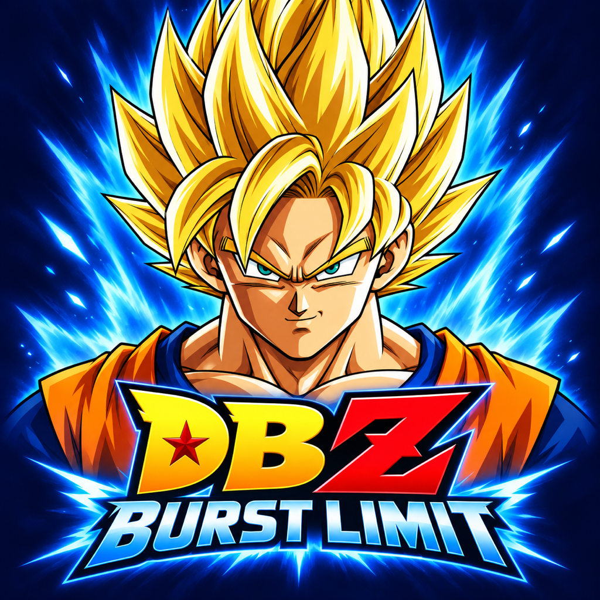

<p align="center">
  
</p>

# DBZ Burst Limit — Android, Apple Silicon and LAN

Native ARM64 ports of **Dragon Ball Z: Burst Limit for Xbox 360**, with Android touch controls, gamepad support, first-launch game installation and local network battles between Android and Mac.

This is a development port based on [DBZ-Burst-Limit-Recompiled](https://github.com/iExplosiveRage/DBZ-Burst-Limit-Recompiled) and [ReXGlue](https://github.com/iExplosiveRage/rexglue-sdk). The Xbox 360 PowerPC code is translated to C++ ahead of time and compiled into the app. Rendering uses Vulkan on Android and MoltenVK on Apple Silicon.

**Bring your own USA/NTSC-U Xbox 360 game.** This repository contains source, build scripts and launcher artwork. It does not include the ISO, the original game executable, CPK archives, videos, audio, extracted game files, saves or generated game code. European/PAL, Australian and Japanese executables are unsupported.

## Start here

| Platform | Install and play | Build from source |
| --- | --- | --- |
| Android | Install a game APK built from this source, open **Burst Limit**, then select your USA `.iso` or extracted-game `.zip` when prompted. | [Android requirements and build instructions](android/README.md) |
| Apple Silicon Mac | Open the complete `burstlimit.app`, then select your USA `.iso` or extracted-game `.zip` when prompted. | [Mac requirements and build instructions](macos/README.md) |
| Android ↔ Mac LAN | Use compatible builds on the same local network. Host creates a public Player Match; guest searches Custom Match. | [LAN setup, controls and troubleshooting](docs/LAN.md) |

The initial publication is source only. An APK or Mac app must be built separately; there is no bundled installer in this Git repository. Each person building the game needs the supported executable locally. People running a built app use its first-launch file picker.

## Requirements to play

| | Android | Mac |
| --- | --- | --- |
| CPU | 64-bit ARM device running a 64-bit Android system (`arm64-v8a`) | Apple Silicon M1 or newer (`arm64`) |
| OS | Android 11 / API 30 or newer; target/compile SDK is 36 | Current local build targets macOS 26.5 or newer; testing was on macOS 27.2. Earlier deployment targets have not been validated. |
| Graphics | Vulkan 1.1 or newer, plus the runtime's required device features, including fragment shader stores/atomics. An OS version or GPU brand alone does not establish compatibility. | Metal through the app's bundled Vulkan loader and MoltenVK; retain the complete `.app` bundle. |
| Game | Your USA Xbox 360 ISO, or ZIP containing extracted USA game files | Same |
| Storage | About 3.4 GB extra space for extracted files, plus the app, saves and your source ISO/ZIP | Same; source builds need substantially more space |
| Input | Touch overlay, or Android-recognized USB/Bluetooth gamepad | Keyboard, or SDL-compatible gamepad |
| Multiplayer | Same local IPv4 network, UDP traffic allowed, compatible build and gameplay settings on both devices | Same |

For comfortable testing, use a recent device with at least 8 GB RAM. This is a recommendation, not a measured minimum. More demanding scenes, shader compilation and thermal throttling can affect performance. Development builds are not a guarantee of full-game compatibility or a fixed frame rate.

Mali support includes compressed-texture decode fallbacks and a compute path for vertex memory exports. Adreno and other Vulkan devices still require testing; the port does not require a vendor-specific replacement driver. See [device results and remaining limits](docs/compatibility.md).

## First launch and game files

1. Finish copying your own USA Xbox 360 ISO or extracted-game ZIP to the device. On Android, **Downloads** is a convenient location.
2. Open **Burst Limit**. When no valid installation exists, the app opens the system file picker before starting the game renderer.
3. Select a **`.iso`**, or a **`.zip` containing the extracted game files**. A ZIP containing an ISO must be unpacked first. `.7z`, `.rar` and incomplete downloads are not accepted directly.
4. Wait for validation and copying. Progress and cancellation are available. The original archive is kept. Setup publishes the new game directory only after successful verification.
5. Later launches reuse the verified installation and skip the picker. Existing valid installations also skip setup.

The expected executable is:

| Property | Value |
| --- | --- |
| Filename | `default.xex` |
| Region | USA / NTSC-U |
| Size | 7,983,104 bytes |
| SHA-1 | `aec598f88cf51181fc377b148e0b1ad30db4485c` |

Check an extracted executable on Mac with `shasum -a 1 game_data_root/default.xex`. Do not bypass validation for a different region: the translated code and fixed hooks depend on this executable.

An extracted-game ZIP may contain these paths at its root or beneath one enclosing folder:

```text
game_data_root/
├── default.xex
└── LONG2DATA/
    ├── LONG2DATA_US.CPK
    ├── STREAM_US.CPK
    ├── STREAM_JP.CPK
    ├── SFD/
    └── SOUND/
```

Keep all files extracted from the game, including videos and sound. The installer validates the executable and required archives; those checks are not a substitute for keeping the complete game content.

| Data | Location |
| --- | --- |
| Android game installation | App external storage: `Android/data/org.burstlimit.android/files/game_data_root` (internal app storage is the fallback) |
| Android settings and saves | App storage, including `files/user_data`; control/LAN preferences use private Android preferences |
| Finder-launched Mac installation, settings and saves | `~/Library/Application Support/Burst Limit/` |
| Mac source launcher saves | `out/mac-user-data/`; `macos/run.sh` selects this separate profile |

Do not uninstall the Android app or clear its data unless you intend to remove its stored data. Updating with the same package and signing key preserves app data. Rebuilding a debug APK on another computer can use a different signing key, causing an update to be rejected.

## Controls

Android's **Controls** tab at the top of the screen provides:

- **On-screen controls**: both sticks, D-pad, A/B/X/Y, shoulder buttons, triggers, stick clicks, Back and Start. The visibility preference is saved.
- **Gamepad takeover**: touch input hides automatically when a recognized USB or Bluetooth gamepad is connected; it returns after the last controller disconnects if enabled.
- **LAN play**: automatic discovery by default, an Offline option and an optional manual host address. Fully close and reopen the game after changing the LAN mode.
- **Gamertag**: set a 1–15 character printable name without restarting. A player already in a room may need to leave and rejoin to refresh a cached name.

Mac keyboard controls include **Enter = Start**, **Space = A**, **Backspace = B**, **WASD = movement**, **L = X**, and **P = Y**. Use F1, or Back + Start on a controller, for the runtime settings. Source-launch keyboard mode is enabled with `--mnk_mode=true`. See the [Mac guide](macos/README.md) for the complete mapping and gamertag configuration.

## Local network fighting

Connect both devices to the same local network. LAN is enabled by default. No Xbox account, subscription or internet lobby service is needed for this direct LAN path.

1. Host: **Versus → Online Battle → Player Match → Create Match**. Turn **Private Session off**.
2. Guest: **Versus → Online Battle → Player Match → Custom Match**. Use broad search criteria, such as Random, and select the host's gamertag.
3. Both players choose **Ready**, then select fighters and the stage.

Automatic discovery lists actual compatible public rooms by gamertag, so entering an IP address is normally unnecessary. Builds must advertise the same compatibility version; build both platforms from the same Git commit and tag state. Use matching gameplay settings/mods. Public internet matchmaking is not implemented for these ports. [Full LAN instructions](docs/LAN.md) cover firewall settings, manual addressing and connection failures.

## Get the source

```sh
git clone --recursive https://github.com/nahalewski/DBZBL-Android-LAN.git
cd DBZBL-Android-LAN
python3 scripts/apply_android_sdk_patch.py
```

If you cloned without `--recursive`, run `git submodule update --init --recursive` first. The SDK stays pinned to `66de2e369bc98c85e9e79c7128b19f49a1f6a967`. The patch includes the shared Android/Mac runtime, renderer and LAN changes. Apply it before any host or device build. It checks the revision and refuses conflicting local edits. `macos/build.sh` also applies the included MoltenVK lifetime patch.

Build instructions: [Android](android/README.md#build-from-source) · [Mac](macos/README.md#build-from-source). Generated game code is produced locally from your executable and stays ignored by Git.

## Development status

Bounded offline and cross-platform LAN fights were verified on an M1 Pro Mac and the first-generation Pixel Fold. Pixel 9 Pro Fold startup, compressed textures and app-switch surface recovery were checked. Samsung Galaxy Tab S11 Ultra first-launch import and intro rendering were checked; complete gameplay on the current Samsung build remains unverified. Razer Edge 5G was skipped. Extended stability, full campaign, audio, all GPU families and 16 KB Android device execution still need coverage. See [compatibility](docs/compatibility.md).

## Credits and third-party code

The original recompilation and gameplay integration are by [iExplosiveRage](https://github.com/iExplosiveRage/DBZ-Burst-Limit-Recompiled), using the [ReXGlue SDK](https://github.com/rexglue/rexglue-sdk). This repository adds the Android and Apple Silicon ports, platform setup, touch controls and direct LAN improvements. Existing upstream history and notices are retained. Third-party dependencies retain their own licenses and notices in their source trees. Dragon Ball Z: Burst Limit and its game assets belong to their respective rights holders; no ownership of the original game is claimed.
